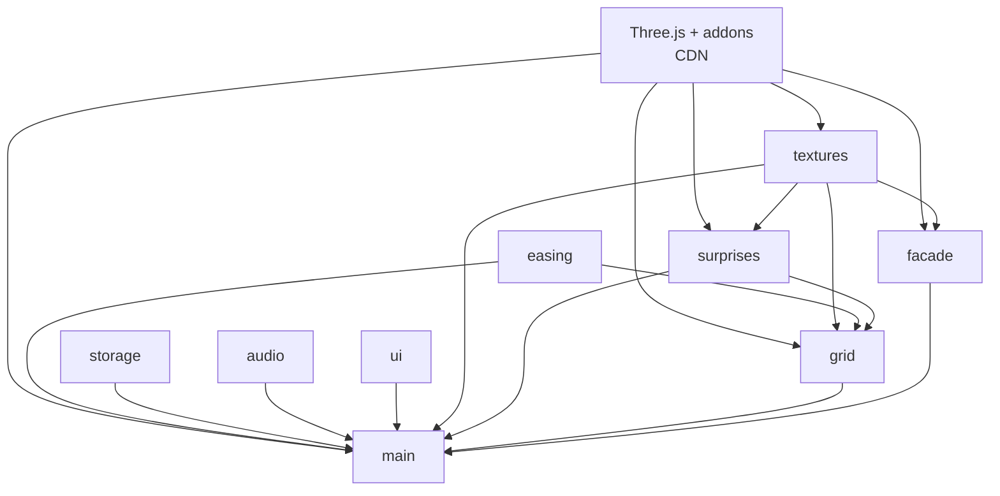
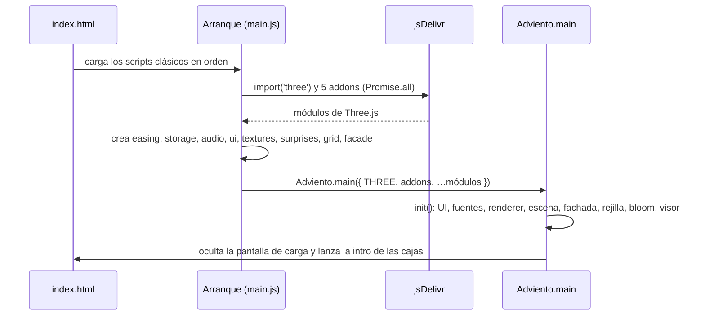
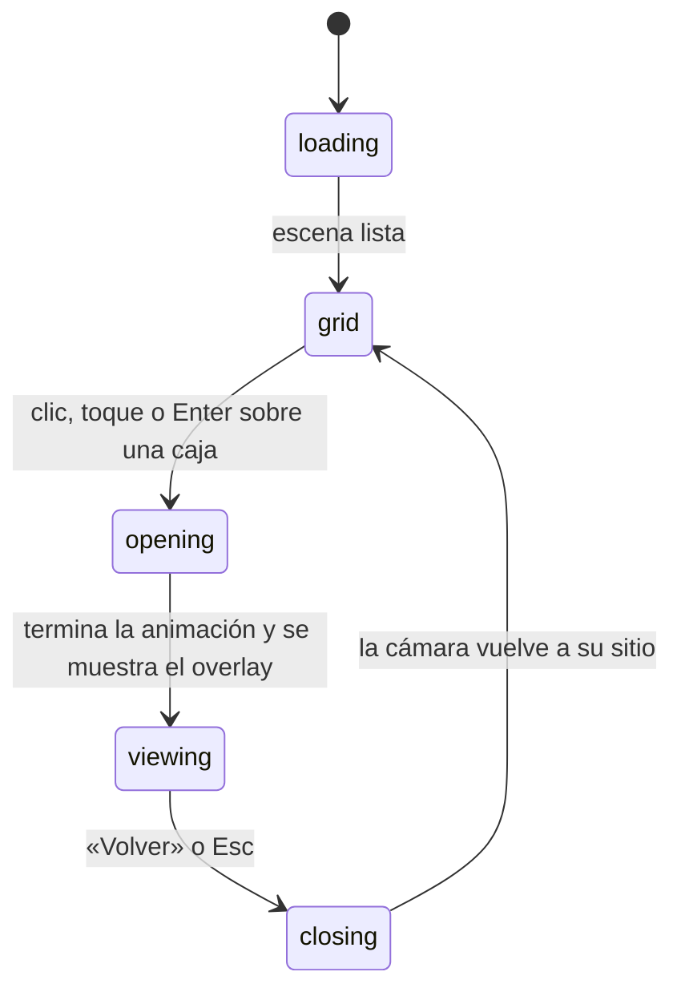

# Documentación del código · Calendario de Adviento 3D

Este documento explica cómo está construido el calendario: arquitectura, flujo de ejecución, módulos y sus funciones públicas, y cómo hacer los cambios más habituales. Para saber **cómo abrirlo y usarlo**, consulta el [README](README.md).

---

## Índice

1. [Visión general](#1-visión-general)
2. [Arquitectura](#2-arquitectura)
3. [Arranque de la aplicación](#3-arranque-de-la-aplicación)
4. [Ciclo de vida y estados](#4-ciclo-de-vida-y-estados)
5. [Referencia de módulos](#5-referencia-de-módulos)
6. [Estructura del HTML y CSS](#6-estructura-del-html-y-css)
7. [Rendimiento](#7-rendimiento)
8. [Accesibilidad](#8-accesibilidad)
9. [Guía de cambios habituales](#9-guía-de-cambios-habituales)
10. [Resolución de problemas](#10-resolución-de-problemas)

---

## 1. Visión general

| Aspecto | Detalle |
|---|---|
| Tecnologías | HTML, CSS y JavaScript (scripts clásicos, sin frameworks ni bundlers) |
| Librería externa | Three.js **0.169.0** (núcleo, `OrbitControls` y posprocesado de bloom), desde jsDelivr |
| Fuentes | Google Fonts: **Fredoka** (títulos y números de las cajas) y **Nunito** (interfaz) |
| Servidor | No hace falta: se abre con doble clic en `index.html` (`file://`) |
| Persistencia | `localStorage`, clave `calendario-adviento:v1` |
| Recursos externos | Ninguna imagen ni audio: texturas con `<canvas>` y sonido con Web Audio API |

### Árbol de archivos

```
index.html            Estructura de la página, importmap y orden de carga de scripts
css/styles.css        Estilos de la interfaz (fachada de juguetería, responsive, movimiento reducido)
js/easing.js          Easings y gestor de animaciones (tweens)
js/storage.js         Lectura y escritura del progreso en localStorage
js/audio.js           Música y efectos sintetizados con Web Audio API
js/ui.js              Capa HTML: carga, título, botones, overlay, modal y foco
js/textures.js        Texturas generadas con <canvas>
js/surprises.js       Las 24 sorpresas 3D
js/grid.js            Las 24 cajas de regalo y su lógica
js/facade.js          Fachada de juguetería (marco, bombillas, toldo, soldaditos…)
js/main.js            Escena, cámara, render, bucle, interacción y arranque
calendario-adviento.zip  Copia descargable del proyecto
```

---

## 2. Arquitectura

### Por qué scripts clásicos y no módulos ES

Los navegadores bloquean los módulos ES locales (`<script type="module" src="js/…">`) cuando la página se abre con `file://`. Para que funcione sin servidor:

- Cada archivo de `js/` es un **script clásico** envuelto en una función autoejecutable (IIFE).
- Cada uno registra una **fábrica** en el objeto global `window.Adviento`. La fábrica recibe sus dependencias en un objeto `deps` y devuelve su API pública.
- **Three.js** se carga con `import()` dinámico desde el CDN. Las rutas `'three'` y `'three/addons/…'` se resuelven con el `<script type="importmap">` de `index.html`. jsDelivr envía cabeceras CORS, así que esta carga sí funciona desde `file://`.

Patrón común a todos los archivos:

```js
(function () {
  'use strict';
  const Adviento = (window.Adviento = window.Adviento || {});

  Adviento.nombreModulo = function (deps) {
    const THREE = deps.THREE;                    // dependencias inyectadas
    const { algo } = deps.otroModulo;

    function funcionPublica() { /* … */ }

    return { funcionPublica };                   // API pública
  };
})();
```

### Dependencias entre módulos



`easing`, `storage`, `audio` y `ui` no dependen de Three.js.

### Orden de carga en `index.html`

```html
<script src="js/easing.js"></script>
<script src="js/storage.js"></script>
<script src="js/audio.js"></script>
<script src="js/ui.js"></script>
<script src="js/textures.js"></script>
<script src="js/surprises.js"></script>
<script src="js/grid.js"></script>
<script src="js/facade.js"></script>
<script src="js/main.js"></script>   <!-- siempre el último: contiene el arranque -->
```

Cargar un script solo **registra** su fábrica; nada se ejecuta hasta el arranque. Aun así, `main.js` debe ir el último porque al cargarse lanza el arranque.

---

## 3. Arranque de la aplicación

El arranque está al final de `js/main.js`:



Dentro de `Adviento.main`, la función `init()` hace, en orden:

1. Ajusta la escala de movimiento (`setMotionScale`) y la calidad de partículas (`setSurpriseQuality`).
2. Inicializa el audio (sin crear aún el `AudioContext`) y la interfaz (`initUI`).
3. Espera a las fuentes (máximo 2 s) para que los números de las cajas salgan con Fredoka.
4. Crea el `WebGLRenderer`. Si falla, muestra un mensaje de error en la pantalla de carga.
5. Monta la escena: fondo, luces, estrellas, luna, nieve, fachada y rejilla, y restaura las cajas ya abiertas.
6. En escritorio, prepara el bloom (`EffectComposer` + `UnrealBloomPass` + `OutputPass`).
7. Crea el visor del overlay (`SurpriseViewer`), ajusta el tamaño y conecta los eventos.
8. Compila los shaders, arranca el bucle `requestAnimationFrame` y, tras un mínimo de 700 ms, oculta la pantalla de carga. Por último marca `window.__adventReady = true`.

Hay dos redes de seguridad para los errores de carga:

- Si `import()` de Three.js falla, el `.catch` del arranque muestra «No se pudo cargar Three.js…».
- Un temporizador en línea en `index.html` muestra un aviso si a los 15 s `window.__adventReady` sigue sin estar activo.

---

## 4. Ciclo de vida y estados

`main.js` guarda el estado en el objeto `state`:

| Campo | Tipo | Descripción |
|---|---|---|
| `opened` | `Set<number>` | Días abiertos (1–24) |
| `muted` | `boolean` | Sonido silenciado |
| `mode` | `string` | Estado de la máquina (ver abajo) |
| `day` | `number \| null` | Día que se está mostrando |

### Máquina de estados



- Solo se acepta abrir una caja en `grid`, y solo se acepta volver en `viewing`. Así se evitan dobles clics durante las animaciones.
- **Reiniciar calendario** solo actúa en `grid`.

### Secuencia de apertura (`openDay`)

1. La cámara se acerca a la caja (`moveCamera`, 0,9 s).
2. Si la caja estaba cerrada: suena el papel (`playPaper`) y se desenvuelve (`grid.unwrap`): el lazo se deshace, la tapa salta y sale un destello de partículas. Se guarda el progreso, suena la campanilla (`playChime`) y la sorpresa emerge girando (`grid.emerge`).
3. Si ya estaba abierta: campanilla y la sorpresa se eleva de nuevo.
4. Se muestra el overlay (`ui.showOverlay`) y el visor 3D (`viewer.show`).

`closeDay` hace lo contrario: oculta el overlay, la sorpresa vuelve a reposar sobre la caja (`grid.settle`) y la cámara regresa a su posición.

---

## 5. Referencia de módulos

### 5.1 `easing.js` — animaciones

Gestor propio de *tweens* sincronizado con el bucle principal. No usa librerías.

| Exporta | Descripción |
|---|---|
| `Ease` | Funciones de easing: `linear`, `inQuad`, `outQuad`, `inCubic`, `outCubic`, `inOutCubic`, `inOutSine`, `outBack`, `outElastic` |
| `tween({ duration, delay, ease, onUpdate, onComplete })` | Crea una animación y devuelve una **promesa** que se resuelve al terminar. `onUpdate(valorConEasing, progresoLineal)` se llama en cada fotograma |
| `wait(segundos)` | Espera sincronizada con el bucle (útil con `await`) |
| `updateTweens(tiempo)` | Avanza todas las animaciones; `main.js` la llama una vez por fotograma (tiempo en segundos) |
| `setMotionScale(escala)` | Multiplica las duraciones futuras (0,55 con movimiento reducido) |
| `lerp(a, b, t)`, `clamp(v, min, max)` | Utilidades numéricas |

Ejemplo:

```js
await tween({
  duration: 0.8,
  ease: Ease.outBack,
  onUpdate: (e) => objeto.scale.setScalar(e),
});
```

### 5.2 `storage.js` — persistencia

| Exporta | Descripción |
|---|---|
| `loadState()` | Devuelve `{ opened: number[], muted: boolean }`. Filtra valores inválidos y, si falla el acceso, devuelve el estado por defecto |
| `saveState({ opened, muted })` | Guarda el estado (`opened` puede ser un `Set` o un array). Devuelve `true` o `false` |

Todos los accesos a `localStorage` van envueltos en `try/catch` (modo privado, almacenamiento bloqueado o cuota llena).

### 5.3 `audio.js` — música y efectos

Todo el sonido se sintetiza con Web Audio API. El `AudioContext` se crea **solo tras la primera interacción** del usuario, como exigen los navegadores.

| Exporta | Descripción |
|---|---|
| `initAudio({ muted })` | Guarda el estado inicial y suspende o reanuda el audio al cambiar de pestaña |
| `unlock()` | Crea o reanuda el contexto y arranca la música si no está silenciada. Se llama en cada `pointerdown` o `keydown` |
| `setMuted(valor)` / `isMuted()` | Silencia con un fundido corto y para o arranca la música |
| `playPaper()` | Papel arrugándose (ráfagas de ruido filtrado) y un rasgado |
| `playChime()` | Campanilla: arpegio de notas con parciales inarmónicos |
| `playSoftBell()` | Tintineo suave (al reiniciar) |

**Cómo funciona la música:**

- **Melodía:** estribillo de «Jingle Bells» (de dominio público), con acompañamiento «um-pa» en 4/4. Las notas están en `MELODY` (pares `[nota MIDI, pulsos]`) y los acordes en `BARS`/`CHORDS`. Se precalculan en `EVENTS`.
- **Programador:** un `setInterval` de 60 ms (`scheduler`) programa las notas con 0,3 s de antelación sobre el reloj del `AudioContext`, así el ritmo no depende del hilo principal.
- **Timbre de carillón:** cada nota suma tres senos (fundamental, ×2 y ×5,4) con ataque rápido y caída exponencial.
- **Grafo:** `master` → destino. `musicBus` alimenta un eco (delay con realimentación filtrada) y `sfxBus` lleva los efectos.

### 5.4 `ui.js` — capa HTML

`initUI(handlers)` recibe los callbacks `{ onOpenDay, onClose, onToggleMute, onReset, onFocusDay }` y devuelve:

| Método | Descripción |
|---|---|
| `hideLoader()` / `showError(mensaje)` | Pantalla de carga |
| `setOpened(set)` | Actualiza el contador («N de 24 abiertas») y las etiquetas aria de los botones de días |
| `setMuted(bool)` | Estado visual y aria del botón de sonido |
| `setBusy(bool)` | Añade la clase `is-busy` al `body` (oculta la pista inferior durante las animaciones) |
| `showOverlay(día, { title, text })` / `hideOverlay()` | Abre y cierra el diálogo de la sorpresa, gestionando el foco |
| `viewerCanvas` | El `<canvas id="viewer">` del overlay |

Además, `initUI`:

- Convierte el título en letras de colores: cada palabra va en un `span.word` para que no se parta, y cada letra en un `span.ch` con su color.
- Genera los 24 botones accesibles de los días.
- Implementa el modal de confirmación propio, la trampa de foco y la tecla `Esc`. Mientras hay un diálogo abierto, marca `#app-ui` como `inert`.

### 5.5 `textures.js` — ilustraciones con canvas

| Exporta | Descripción |
|---|---|
| `paperStyle(día)` | `{ bg, ink, pattern }` del papel de ese día: 12 colores × 6 motivos (estrellas, copos, rayas, lunares, rombos, ondas) sin repetir combinación |
| `isLight(hex)` | Indica si un color es claro (para elegir contrastes) |
| `createBoxTextures(día)` | `{ paper, front }`: papel de los laterales (256²) y cara frontal con la etiqueta y el número (512×436) |
| `getGlowTexture()` | Halo radial para sprites aditivos |
| `createSnowflakeTexture()` | Copo para `THREE.Points` |
| `createBackgroundTexture()` | Degradado del cielo |
| `createWallTexture()` | Papel pintado de la fachada (rayas, estrellitas y acebo; repetible) |
| `createMoonTexture()` | Superficie lunar |
| `createCandyTexture()` | Rayas diagonales rojo y blanco repetibles |

Las texturas compartidas se guardan en caché (`cached`), así que llamar varias veces a la misma función devuelve la misma textura. Para que el resultado sea estable, se usa un generador pseudoaleatorio con semilla (`mulberry32`).

### 5.6 `surprises.js` — las 24 sorpresas

Cada sorpresa es una función `crearX()` que devuelve un `THREE.Group`, construido solo con geometrías de Three.js.

| Día | Función | Sorpresa | Animación |
|---|---|---|---|
| 1 | `crearEstrella` | Estrella | Gira, flota y la orbitan chispas |
| 2 | `crearCopoNieve` | Copo de nieve | Rota y se balancea |
| 3 | `crearMunecoNieve` | Muñeco de nieve | Se balancea |
| 4 | `crearArbol` | Árbol de Navidad | Gira; la estrella de arriba rota |
| 5 | `crearBola` | Bola de Navidad | Gira y se mece |
| 6 | `crearBaston` | Bastón de caramelo | Gira |
| 7 | `crearCampana` | Campana | Péndulo con badajo |
| 8 | `crearVela` | Vela | Llama que parpadea |
| 9 | `crearCalcetin` | Calcetín | Se mece |
| 10 | `crearGorro` | Gorro de Papá Noel | Gira; el pompón rebota |
| 11 | `crearRegalo` | Regalo pequeño | Gira; la tapa da saltitos |
| 12 | `crearCasita` | Casita nevada | Ventanas encendidas; vaivén |
| 13 | `crearTrineo` | Trineo | Se desliza y balancea |
| 14 | `crearReno` | Reno | Cabeceo; la nariz brilla |
| 15 | `crearCorona` | Corona de Adviento | Cuatro llamas; gira |
| 16 | `crearGalleta` | Galleta de jengibre | Da saltitos |
| 17 | `crearTaza` | Taza de chocolate | Vapor que sube |
| 18 | `crearFarol` | Farol | Llama interior; gira |
| 19 | `crearAngel` | Ángel | Aletea y flota |
| 20 | `crearLuna` | Luna con estrellas | Las estrellas orbitan |
| 21 | `crearBolaNieve` | Bola de nieve | Nieve que cae dentro del cristal |
| 22 | `crearAbetoLuces` | Abeto iluminado | Luces que parpadean |
| 23 | `crearEstrellaFugaz` | Estrella fugaz | Estela y chispas |
| 24 | `crearGranEstrella` | Gran estrella | Rayos y explosión de partículas |

| Exporta | Descripción |
|---|---|
| `SURPRISES` | Array de `{ title, text, create }`, uno por día (índice = día − 1) |
| `getSurpriseInfo(día)` | `{ title, text }` para el overlay |
| `createSurprise(día, tamaño)` | Construye la sorpresa **normalizada**: escalada para que su dimensión mayor mida `tamaño` y con la base en `y = 0`. Devuelve un grupo con `userData.update(t, dt)`, `userData.height` y `userData.dispose()` |
| `setSurpriseQuality({ explosion, globeSnow, sparkles, reduced })` | Número de partículas y modo de movimiento reducido |

**Convenciones internas:**

- **Cachés:** `geo(clave, crear)` y `mat(clave)` (definiciones en `MATERIALS`). La miniatura de la rejilla y la vista ampliada reutilizan las mismas geometrías y materiales.
- **Animación:** cada sorpresa anima solo un subgrupo `rig` (o sus hijos) desde `userData.update(t, dt)`. El grupo raíz no se toca, porque `createSurprise` usa su posición y escala para normalizar.
- **`oncePerFrame(clave, t, fn)`:** evita simular dos veces por fotograma la geometría dinámica compartida (nieve de la bola, chispas, explosión).
- **Elementos que no cuentan para el tamaño:** los objetos con `userData.noBounds = true` (sprites de brillo, rayos) se ignoran al calcular el tamaño. Para elementos etéreos como la estela del día 23 se usa `boundsBox(...)`, una caja invisible que fija el tamaño.
- **Brillo:** los colores con valores > 1 (por ejemplo, `new THREE.Color(2.4, 1.3, 0.35)`) son los que brillan con el bloom.
- **Ayudantes:** `makeFlame` (llama reutilizable con `userData.flicker`), `buildTree` y `treeRadius` (árbol base), `makeBow` (lazo), `starGeometry` y `starMesh` (estrella extruida).

### 5.7 `grid.js` — las cajas

Constantes principales: separación `SX = 1.62` y `SY = 1.9`, inclinación hacia la cámara `TILT = 0.3`, alto del cuerpo `BODY_H = 0.85` y tamaño de la miniatura `MINI_SIZE = 0.8`.

**Jerarquía de cada caja:**

```
root (posición en la rejilla + hover)
├─ tilt (inclinación hacia la cámara)
│  ├─ body      cuerpo; la cara frontal lleva el número
│  ├─ lid       tapa + cintas
│  ├─ bow       lazo (4 lazadas + nudo)
│  └─ holder    soporte de la mini sorpresa (contrarresta la inclinación)
│     └─ spinner → mini sorpresa
└─ glow (sprite de brillo de las cajas abiertas)
```

**Clase `AdventGrid(scene, { burstCount, reduced })`:**

| Método | Descripción |
|---|---|
| `layout(cols)` | Coloca las cajas en 6×4 (`cols = 6`) o 4×6 (`cols = 4`). Las cajas se deslizan suavemente a su nueva posición |
| `getSize()` | `{ width, height }` de la rejilla |
| `getFocusPoint(día, out)` | Punto al que mira la cámara al abrir una caja |
| `pick(raycaster)` | Día bajo el puntero o `null` |
| `setHover(día)` / `setFocusDay(día)` | Caja resaltada por el ratón o por el teclado |
| `intro()` | Aparición escalonada al cargar |
| `unwrap(día)` | *async*: lazo, tapa y destello |
| `emerge(día)` | *async*: la sorpresa sale girando por encima |
| `settle(día)` | La sorpresa vuelve a reposar sobre la caja |
| `setOpenedInstant(día)` | Deja una caja abierta sin animación (al restaurar el progreso) |
| `reset()` | Cierra todas las cajas con un «pop» de las tapas |
| `update(t, dt)` | Hover, flotación, giro de las miniaturas, brillo y partículas |

La clase interna **`Burst`** es un sistema de partículas reutilizable para el destello al abrir, con gravedad, rozamiento y desvanecimiento.

### 5.8 `facade.js` — fachada de juguetería

**Clase `Facade(scene, { reduced })`:**

| Método | Descripción |
|---|---|
| `build(anchoRejilla, altoRejilla, vertical)` | Reconstruye las piezas que dependen del tamaño: pared, marco, bombillas, toldo, escenario y columnas. Se llama al cambiar entre 6×4 y 4×6 |
| `getExtents()` | `{ width, height, centerY }` que debe encuadrar la cámara (incluye columnas y soldaditos en horizontal) |
| `update(t)` | Bombillas que se persiguen y soldaditos marchando |

Detalles:

- **Bombillas:** son un `InstancedMesh` a lo largo del perímetro del marco (una cada `BULB_STEP = 0.42`). En cada fotograma se rota el color de cada instancia entre los 4 de `BULB_COLORS`, y una de cada tres queda tenue.
- **Toldo:** festones de medio disco en otro `InstancedMesh`, alternando rojo y blanco.
- **Soldaditos:** se crean una vez (`_createSoldier`), tienen piernas y brazos con pivote y solo son visibles en horizontal.

### 5.9 `main.js` — escena y orquestación

| Elemento | Descripción |
|---|---|
| `QUALITY` | Ajustes según el dispositivo (bloom y número de copos, estrellas y partículas). «Bajo consumo» significa puntero táctil o pantalla < 640 px |
| `createStars(n)` | `THREE.Points` con un `ShaderMaterial` propio que hace titilar cada estrella con su fase y color |
| `createMoon()` | Esfera con textura y halo (solo en horizontal) |
| `createSnow(n)` | Copos que caen y se reciclan dentro de un volumen que se adapta al encuadre |
| `SurpriseViewer` | Segundo `WebGLRenderer` en el overlay, con `OrbitControls` (arrastrar o pellizcar), autorrotación, halo y animación de entrada |
| `computeHome()` | Calcula la distancia de cámara para que la fachada quepa entre el título (20 % superior) y los botones (8–10 % inferior) |
| `moveCamera(pos, objetivo, duración)` | Desplazamiento suave de la cámara |
| `openDay` / `closeDay` | Secuencias descritas en la sección 4 |
| `toggleMute` / `resetCalendar` | Acciones de los botones |
| `bindPointer()` | Eventos pointer: hover con ratón, toque en táctil (un movimiento de más de 12 px no cuenta como clic), paralaje y desbloqueo del audio |
| `onResize()` | Ajusta renderer, bloom, cámara, rejilla y fachada |
| `loop(ahora)` | Bucle `requestAnimationFrame`: tweens, cielo, nieve, rejilla, fachada, cámara, render y visor |

---

## 6. Estructura del HTML y CSS

### Elementos principales de `index.html`

| ID / clase | Función |
|---|---|
| `#loader` | Pantalla de carga con estrella animada; también muestra errores |
| `#scene` | Canvas de la escena 3D |
| `#app-ui` | Interfaz sobre la escena; se vuelve `inert` con diálogos abiertos |
| `#title`, `#progress` | Título de letras de colores y contador |
| `#day-list` | Lista accesible de días (oculta salvo al recibir foco) |
| `#btn-mute`, `#btn-reset` | Sonido y reinicio |
| `#overlay` | Diálogo de la sorpresa (`#viewer`, `#overlay-day`, `#overlay-title`, `#overlay-text`, `#btn-back`) |
| `#modal` | Confirmación de reinicio (`#modal-cancel`, `#modal-confirm`) |

### Variables de color (`:root` en `styles.css`)

| Variable | Color | Uso |
|---|---|---|
| `--red` / `--red-deep` | `#e0262f` / `#9e1220` | Botones principales, bordes, títulos |
| `--green` / `--green-deep` | `#1f9e5a` / `#13693a` | Etiqueta del día, foco de los días |
| `--yellow` / `--yellow-deep` | `#ffc93c` / `#d89a12` | Botón de sonido, foco, bordes |
| `--cream` | `#fff8ec` | Fondo de tarjetas |
| `--navy`, `--ink` | `#1d3c8f`, `#1b2a5a` | Textos sobre fondo claro |
| `--sky-0` / `--sky-1` | `#0a1f5c` / `#1f5fc0` | Fondo del cielo |

**Puntos de corte:**

- `max-width: 760px` o `max-aspect-ratio: 4/5`: el overlay pasa a una columna.
- `max-width: 480px`: se oculta el subtítulo.
- Pantallas horizontales bajas (`max-height: 520px`): el overlay se compacta.
- `prefers-reduced-motion`: se desactivan las animaciones CSS.

---

## 7. Rendimiento

- **Geometrías y materiales compartidos:** entre cajas y en las cachés de `surprises.js`.
- **`InstancedMesh`:** hojas y bayas de la corona, luces del abeto, bombillas y festones de la fachada.
- **Liberación de memoria:**
  - las sorpresas eliminadas liberan sus `InstancedMesh` con `dispose()`;
  - la fachada libera los suyos al reconstruirse.
  - Las geometrías y materiales cacheados se mantienen a propósito para reutilizarlos.
- **`pixelRatio`** limitado a 2.
- **Dispositivos de bajo consumo:** sin bloom, con menos partículas y con la escena de fondo en pausa mientras se ve una sorpresa.
- **Bloom con umbral alto (1,5):** solo brillan bombillas, llamas y estrellas.
- **Shaders precompilados** con `renderer.compile` antes de mostrar la escena.

---

## 8. Accesibilidad

- **Teclado:** `Tab` recorre los 24 botones de `#day-list` (aparecen como una píldora y resaltan su caja en 3D). `Enter` abre la caja y `Esc` cierra el overlay o el modal.
- **Diálogos:** usan `role="dialog"` y `role="alertdialog"`, con `aria-modal`, trampa de foco y retorno del foco al botón de origen.
- **Etiquetas:** los botones tienen `aria-label`, que se actualiza cuando una caja ya está abierta. El contador usa `aria-live`, y el título conserva su texto completo en `aria-label`, con las letras de colores marcadas como `aria-hidden`.
- **Movimiento reducido:** con `prefers-reduced-motion`, las animaciones duran un 55 %. No hay autorrotación ni paralaje, y las estrellas, las bombillas y los soldaditos se mueven menos.

---

## 9. Guía de cambios habituales

### Cambiar el texto o el título de una sorpresa
Edita la entrada correspondiente del array `SURPRISES` en `js/surprises.js` (índice = día − 1).

### Sustituir una sorpresa por otra
1. Crea una función `crearMiSorpresa()` en `js/surprises.js` que devuelva un `THREE.Group`. Mete las piezas en un subgrupo `rig` y anímalo en `g.userData.update = (t, dt) => { … }`.
2. Usa `geo()` y `mat()` para reutilizar geometrías y materiales.
3. Pon su `create` en la entrada de `SURPRISES` del día deseado. No hace falta preocuparse del tamaño: `createSurprise` lo normaliza.

### Cambiar los colores de los papeles
Edita `PAPER_BASES` en `js/textures.js` (`bg` = fondo, `ink` = motivo). El color de las cintas lo decide `_ribbonFor` en `js/grid.js`.

### Cambiar la música
En `js/audio.js`, edita `MELODY` (pares `[nota MIDI, pulsos]`, `0` = silencio), `BARS` y `CHORDS`. El tempo se ajusta con `BEAT` (segundos por pulso). Do central = 60. La melodía suena una octava más alta (+12).

### Cambiar la fachada
En `js/facade.js`:

- **Bombillas:** colores en `BULB_COLORS`, separación en `BULB_STEP` y velocidad de la persecución en `update`.
- **Marco y toldo:** grosor del marco en `FRAME_T` y tamaño de los festones en `SCALLOP_R`.
- **Materiales:** en `this.mat`.

### Ajustar la calidad o el rendimiento
Modifica `QUALITY` al principio de `js/main.js` (bloom y número de copos, estrellas y partículas).

### Volver a generar el zip
Desde la raíz del repositorio:

```bash
git archive --format=zip --prefix=calendario-adviento/ -o calendario-adviento.zip HEAD
```

Primero haz commit de los cambios: `git archive` empaqueta el último commit, no los archivos sin confirmar.

---

## 10. Resolución de problemas

| Síntoma | Causa probable | Solución |
|---|---|---|
| Se queda en «Preparando la magia…» y luego avisa | Sin conexión al CDN de Three.js | Comprueba la conexión a Internet y recarga la página |
| «No se pudo cargar Three.js» | Bloqueo de red o del navegador al CDN | Prueba otra red o navegador; si persiste, sírvelo con `npx serve .` |
| No suena nada | El audio necesita una interacción previa, o está silenciado | Haz clic en la página; revisa el botón de sonido |
| Los números de las cajas salen con otra fuente | Google Fonts no cargó en 2 s | Se usa una fuente de respaldo; recarga con buena conexión |
| El progreso no se guarda | `localStorage` bloqueado (modo privado o ajustes del navegador) | La app sigue funcionando sin guardar; permite el almacenamiento |
| Va lento en un equipo antiguo | Bloom y partículas | Baja los valores de `QUALITY` o pon `bloom: false` |
| Navegador antiguo sin `importmap` | Safari < 16.4 u otros | Actualiza el navegador |
